# METR4810 Team 2

> **DO NOT PLUG IN USB-C ON THE PCB — this may damage the board.** Use ST-LINK for programming and the USB-to-UART adapter for CLI communication.

## How to use

After flashing and powering the PCB, choose either option:

- **Run switch:** switch **PC11 / SW2** ON to start one two-cut `run2` cycle; switch OFF to stop. No UART or computer connection is needed.
- **UART CLI:** connect through PuTTY to use `run`, `stop`, or control the motor, servo and stepper individually.

Both controls work together: an ON-to-OFF transition can stop a CLI-started run, and `stop` can stop a switch-started run. For switch-only use, complete steps 1–3 and skip the UART/PuTTY setup.

## 1. Clone the repository

Open a terminal in the folder where you want to save the project, then run:

```sh
git clone https://github.com/3jonah3/METR4810-Team2.git
cd METR4810-Team2
```

The project is now saved locally in `METR4810-Team2`.

## 2. Set up STM32CubeIDE

1. Download and install [STM32CubeIDE for Eclipse](https://www.st.com/en/development-tools/stm32cubeide.html).
2. Open CubeIDE and choose a workspace folder.
3. Select **File → Import → General → Existing Projects into Workspace**.
4. Select the repository's `METR4810_Team2_code` folder and click **Finish**.
5. Click **Build** (hammer icon).

The project file to open/import in STM32CubeIDE is:

```text
<your clone folder>\METR4810-Team2\METR4810_Team2_code\.project
```

Select the folder containing this `.project` when importing. Leave **Copy projects into workspace** unchecked. 

Note: TBH, This is very simplifed there is likely a bit more setup to this, where you have to sort out your workspace, use google/AI for help
You may also have to download stm32MX aswell...

## 3. Flash the PCB

1. Connect ST-LINK to the PCB's **J24** header: **SWDIO → IO**, **SWCLK → CLK**, **NRST → RST**. The programming header is missing a GND pin, so connect the **black ST-LINK ground wire to GND on the spare GPIO header**, as shown below. Power the PCB.
2. In CubeIDE, which can be opened by clicking on the .project file, once opened click **Debug** to flash.
3. If it pauses at `main`, click **Resume (F8)** to run the code.


**PCB connection:** GND was accidentally left out of the programming header during the PCB design. Connect the black ST-LINK ground wire to GND on the spare GPIO header, marked by the arrow below.

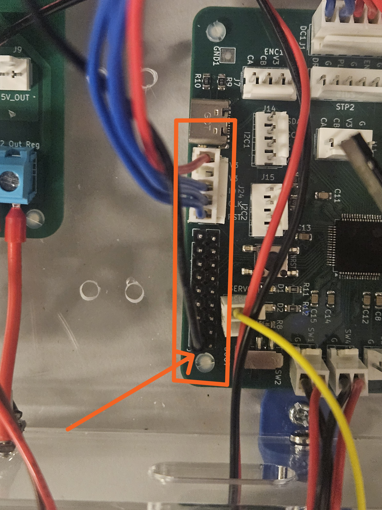

**ST-LINK/V2 orientation:** connect the plug as shown, with the **red wire on the bottom row** in this view.

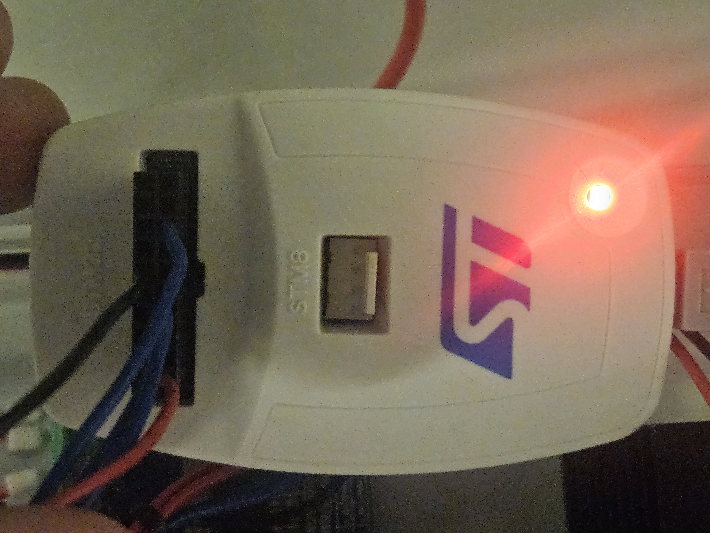

## 4. Connect UART

Set the USB-to-UART adapter to **3.3 V** and connect it to **J19 (UART1)**:

| PCB J19 | USB-to-UART adapter |
|---|---|
| TX — pin 3 / PC4 | RXD |
| RX — pin 4 / PC5 | TXD |
| GND — pin 2 | GND |

**Cross TX and RX.** Leave VCC, RTS and CTS disconnected. Power the PCB separately.

**USB-to-UART adapter:** only RXD, TXD and GND need to connect to the PCB, even though the photo shows leads on all six adapter pins.

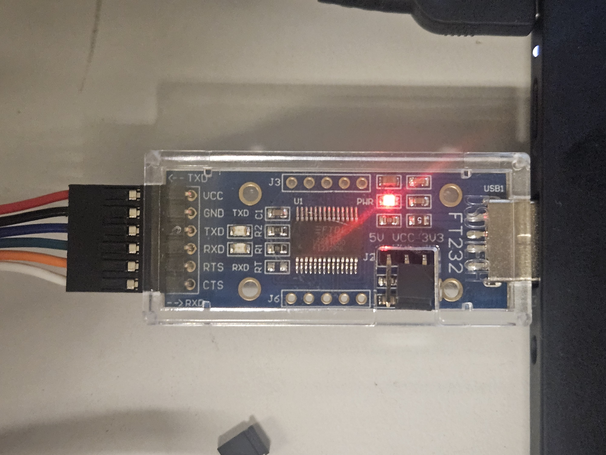

Plug the adapter into your computer. Find its COM number in **Device Manager → Ports (COM & LPT)**.

## 5. Set up PuTTY

Install [PuTTY](https://www.chiark.greenend.org.uk/~sgtatham/putty/latest.html), then set:

| Setting | Value |
|---|---|
| Connection type | Serial |
| Serial line | Your COM port, e.g. COM3 |
| Speed | 115200 |
| Data bits | 8 |
| Stop bits | 1 |
| Parity | None |
| Flow control | None |

Under **Session**, select **Serial**, your COM port and **115200**. COM3 is the example shown below.

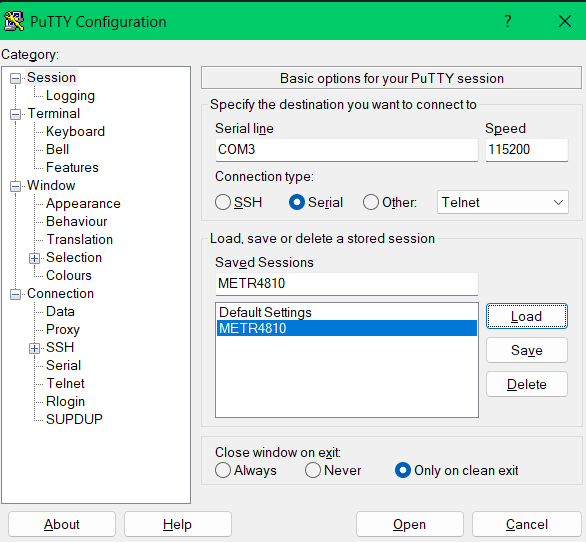

Data bits, stop bits, parity and flow control are under **Connection → Serial**.

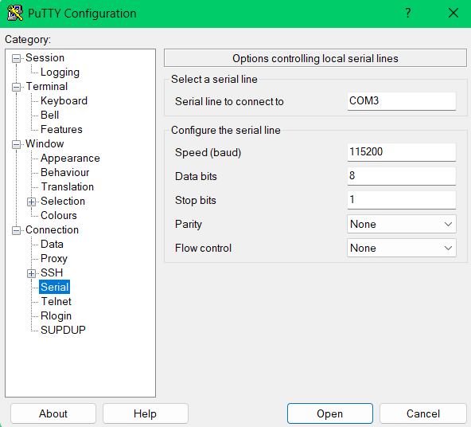

Under **Terminal**, set **Local echo** and **Local line editing** to **Force on**.

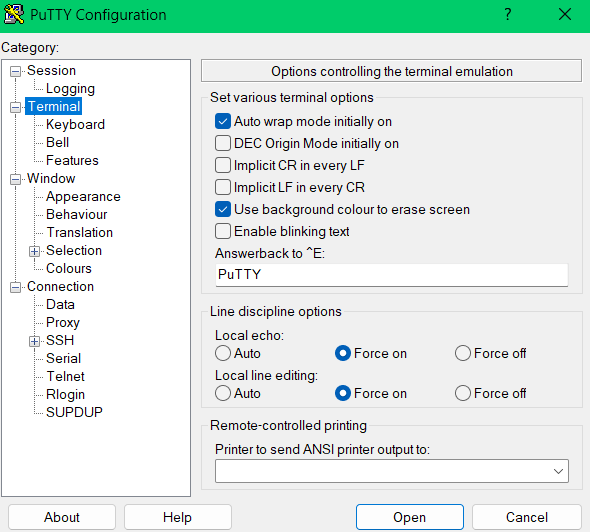

Click **Open**, then reset the PCB to see the welcome message and command list. Type `ping` and press **Enter** — it should reply `OK PONG`.

## 6. CLI commands

Type one command at a time and press **Enter**.

### General

| Command | Action |
|---|---|
| `help` | Show the command guide. |
| `ping` | Check the serial connection. |
| `status` | Show robot state and actuator status. |
| `limits` | Show switch states: 1 = pressed. |
| `speed(750,500,2000)` | Set straight, turning, and return stepper speeds in steps/s. Each must be 16–2000; configure while stopped. |
| `run` | One cycle: home to SW4, drive out to 157,297 steps, return to physical SW4 and stop. The servo follows the schedule and the DC direction follows travel. |
| `pause` | Freeze a run where it is: the stepper and DC motor stop and the servo holds its angle. The run is kept; `run` and manual moves are refused until `continue` or `stop`. |
| `continue` | Resume a paused run from exactly where it stopped, on the same leg with the same drill duty. |
| `stop` | Stop the stepper and DC motor where they are and end the run; the servo holds its angle. |

### Servo

All servo commands use **servo 2**.

| Command | Action |
|---|---|
| `straight()` | Move servo 2 to the current calibrated straight angle, or 90 degrees by default. Keeps the calibration. |
| `servo(95)` | Set angle; range **0–180 degrees**. 95 degrees is the centre, where the pod is straight. |
| `servo(1556u)` | Set pulse width directly; range **500–2500 microseconds**. 1556 us is the centre. |
| `servo(arc)` | Arc test: sweep the run's arc from 90 to 135 degrees over 4 s, hold 1 s, and sweep back over 4 s. Nothing else moves. It ends holding at 90 degrees; `stop` aborts it and the servo holds where it is. |
| `servo(status)` | Show nominal target angle and exact pulse width (not measured position). |
| `servo()` | Show help. |

With the pod fitted, keep servo 2 within **1088–2024 us**, which is the 95 degree arc start ± 23.4 degrees of pod at the nominal scale. The keeper pocket only allows 23.5 degrees. The autonomous run caps itself there; manual `servo(...)` commands do not.

### DC motor

| Command | Action |
|---|---|
| `motor(30)` | Forward at 30% duty. |
| `motor(-30)` | Reverse at 30% duty. Range: **-100 to 100**. |
| `motor(0)` or `motor(stop)` | Stop the motor. |
| `motor(status)` | Show duty cycle. |
| `motor()` | Show help. |

### Stepper

| Command | Action |
|---|---|
| `stepper(20)` | Move 20 steps toward SW4. |
| `stepper(-20)` | Move 20 steps toward SW1. |
| `stepper(speed,100)` | Set speed; range **16–2000 steps/second**. Stop the stepper first. |
| `stepper(auto)` | Move continuously between SW1 and SW4. |
| `stepper(stop)` | Stop the stepper. |
| `stepper(status)` | Show speed, mode and remaining steps. |
| `stepper()` | Show help. |

Counted moves allow up to **1,000,000 steps** in either direction and stop early at a limit. Stop any current stepper movement before starting a new counted move.

### Run feedback

While a run is active the CLI prints its progress without being asked:

| Line | When |
|---|---|
| `RUN STARTED: HOMING TO SW4` | A run starts, from `run` or the PC11 switch. |
| `RUN STARTED: SW4 PRESSED; BACKING OFF 1500 STEPS, THEN HOMING` | A run starts with SW4 already pressed, for example after manually moving onto SW4. |
| `TURN: OUTWARD LIMIT; ...` | Normal counted outward reversal at 157,297 steps, without touching SW1. |
| `TURN: SW4; …` / `TURN: SW1; …` | Physical switch events: SW4 after homing, or an earlier-than-planned SW1 hit. |
| `PAUSED AT: … STEPS (… MM FROM SW4) DURING OUT; …` | After `pause`. No `DATA` rows print while paused. |
| `CONTINUING: OUT` | After `continue`, followed straight away by a `DATA` row. |
| `RUN COMPLETE: SW4 REACHED; POSITION=0 STEPS; ...` | Return finished on physical SW4; servo holds calibrated straight. |
| `SERVO ARC TEST DONE` / `SERVO ARC TEST STOPPED` | A `servo(arc)` sweep finished, or was ended early by `stop`, a manual servo command, `run` or a fault. |
| `DATA,…` | Every 1000 ms (CSV, see below). |
| `STOPPED AT: … STEPS (… MM FROM SW4) DURING OUT; SERVO HOLDING … US` | The run is stopped early: `stop`, the switch or a fault. |
| `FAULT: LIMIT FAULT LATCHED (SW1 AND SW4 PRESSED); …` | Once, when both limits read pressed together. |
| `FAULT: LIMIT FAULT LATCHED (SW4 STILL PRESSED AFTER BACK-OFF); …` | Once, when SW4 has not released after the run-start back-off. |

`DATA` rows are comma-separated, with a header row at the start of each run:

```text
DATA,ms,leg,steps,mm,servo_us,pod_deg,dc,sw1,sw4
DATA,190512,OUT,95000,238.2,1500,0.0,-100,0,0
```

`ms` is time since reset. `leg` is `BACKOFF`, `HOMING`, `OUT` or `RETURN`. `steps` and `mm` are the counted position from SW4 (398.87 steps/mm). `servo_us` is the commanded pulse, and `pod_deg` is the nominal pod-angle offset from the run's 90 degree start (20 us per degree), rather than an absolute angle from the fitted 95 degree centre. `dc` is the drill duty, and `sw1`/`sw4` are the limit switches (1 = pressed). All values are commanded, not measured.

| Command | Action |
|---|---|
| `telemetry(on)` | Turn `DATA` rows on (default). |
| `telemetry(250)` | Print a row every 250 ms; range **100–10000**. |
| `telemetry(off)` | Turn `DATA` rows off. The other lines still print. |

To save a run, turn on PuTTY logging before starting it: **Session → Logging → Printable output**, then choose a file. The lines starting with `DATA,` open directly as CSV in Excel or MATLAB.

## 7. Limit switches and run switch

- **Front limit switch → SW1**.
- **Back limit switch → SW4**.
- **Run switch → SW2 / PC11** (not pictured).

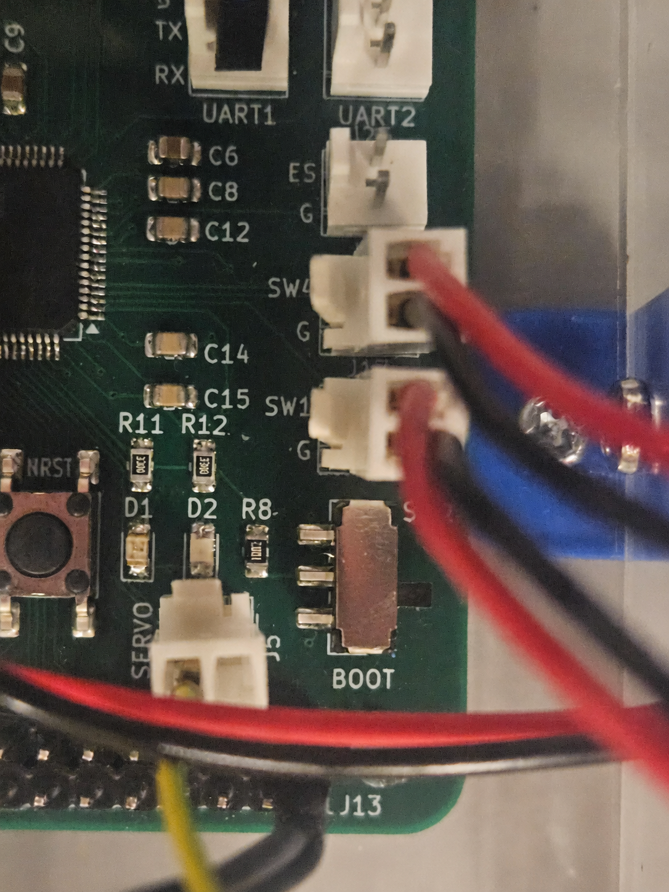

Switch **PC11 / SW2** ON (contact closed to ground) to start one `run2` cycle, and OFF (contact open) to stop the stepper and DC motor while the servo holds its angle. Both transitions use a 30 ms debounce. After completion or `stop`, switch OFF then ON to start another cycle. Leaving the switch ON never repeats the run; ON at reset requires OFF then ON first.

This works without UART connected. The `run` and `stop` commands still work too. The switch is not a UART interlock: CLI commands still work while it is OFF.

## 8. Schematics and PCB routing

Click an image to view it at full size.

### Control PCB schematic

<a href="docs/images/Control_schematic.png">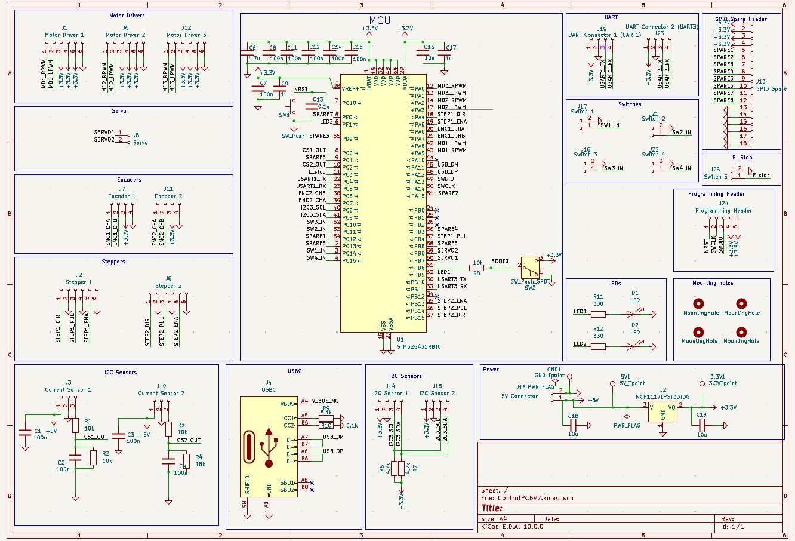</a>

### Control PCB routing

<a href="docs/images/Control_PCB_Routing.png">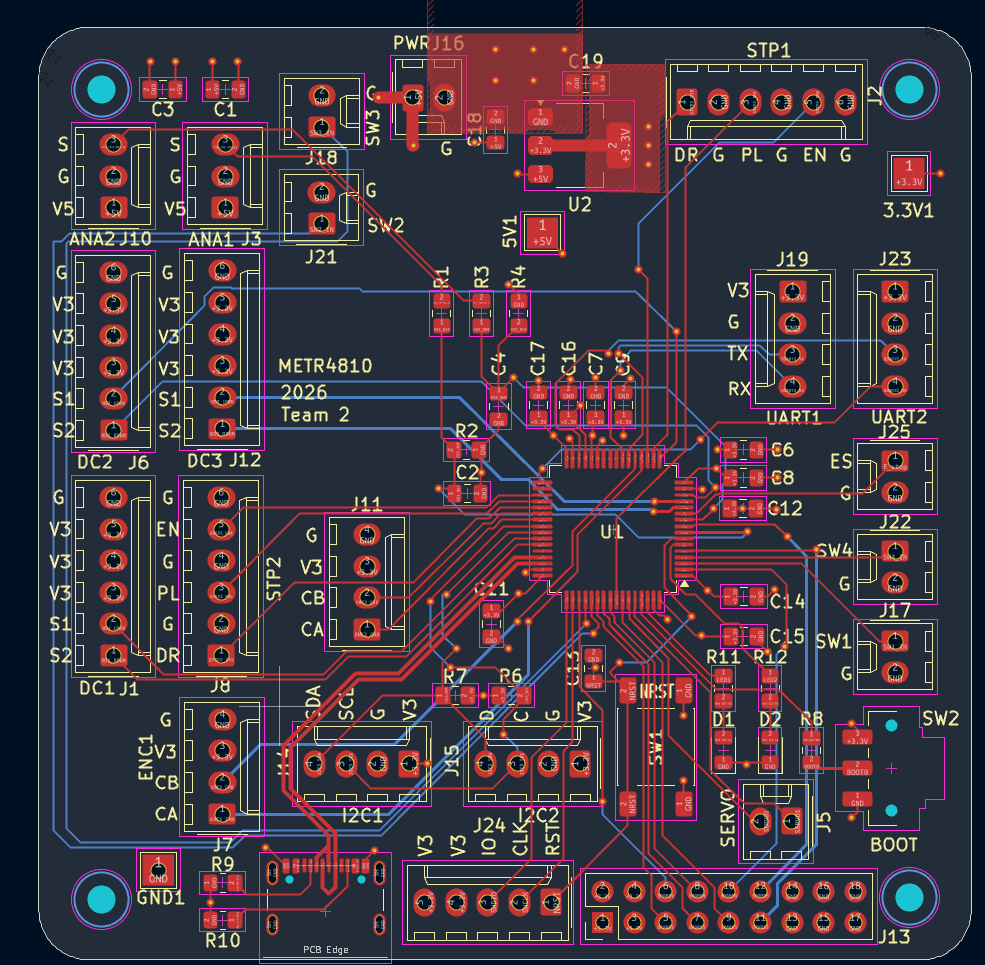</a>

### Power PCB schematic

<a href="docs/images/Power_PCB_Schematic.png">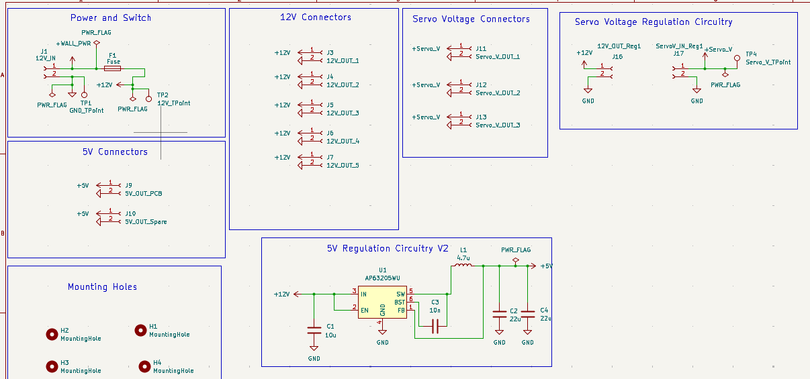</a>

### Power PCB routing

<a href="docs/images/Power_PCB_Routing.png">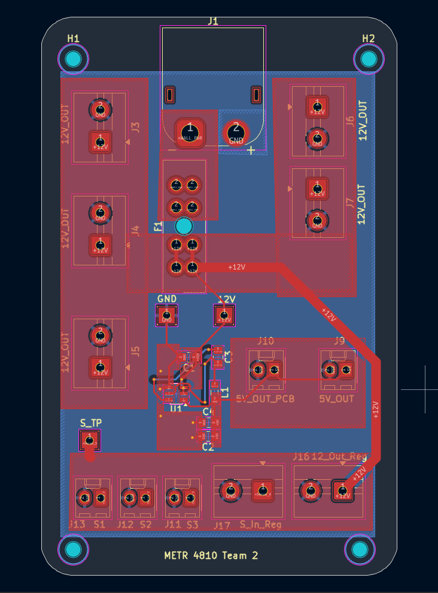</a>

## Important notes

- **Do not plug a USB-C cable into the PCB; it may damage the board.**

- Send `stop` before using individual actuator commands during `run`.
- During `run`, `motor(stop)`, `motor(0)` and `stepper(stop)` stop the whole program.
- If both limit switches trigger together, or SW4 is still pressed after the run-start back-off, a fault latches. Correct the cause and reset the PCB to clear it.
- Closing PuTTY does **not** stop the robot.

## If UART does not work

Check **TX → RX**, **RX → TX**, common GND, the COM port and PuTTY settings. Make sure CubeIDE has not paused the code.

**PB9 flashes when receiving; PF1 flashes when transmitting.**

For more detail, see [SERIAL_CONTROL.md](METR4810_Team2_code/SERIAL_CONTROL.md).

## Modifying the code

Create a new branch before making changes. See [CONTRIBUTING.md](CONTRIBUTING.md).

Ask Jonah if you have any questions.

### Servo pulse widths in firmware

The servo mapping is 0 degrees = 500 us, 90 degrees = 1500 us, and 180 degrees = 2500 us at 50 Hz. The centre, where the pod is straight, is **95 degrees (1556 us)**: `SERVO_CENTRE_ANGLE` in `servo.h`. Both servos start there at power-up with their PWM off, while the run's arc starts separately at **90 degrees (1500 us)** (`DEMO_START_ANGLE` in `robot_control.h`). The CLI controls servo 2 (PB6); `servo(95)` selects degrees and `servo(1556u)` selects microseconds. Send one command per line. `stop` keeps the servo PWM running so it holds its last angle. Switching the PWM off mid-pulse can throw the servo past its limit. Individual commands are rejected during autonomous run or a latched fault.

For C code using robot state and fault checks:

```c
Robot_SetServo(2, 95);             // Degrees; enables servo 2
Robot_SetServoPulseUs(2, 1556);    // Microseconds; enables servo 2
```

Both functions return NULL on success or an error string. The low-level driver also provides `servo(2, 95)` and `Servo_SetPulseUs(2, 1556)`; these return HAL status and require `Servo_Start(2)` to enable output after initialization. In C, `1556u` is an unsigned integer, not a unit: use the separate pulse-width function. `SERVO_ANGLE_US(angle)` in `servo.h` converts an angle to its pulse width. Angles are nominal; confirm the mechanism can accommodate the commanded travel.
### Single-cut sequence (`run`; PC11/SW2 starts `run2`)

1. Home to **SW4 / PC15** with the DC motor off and servo 2 at **1500 us (90 degrees)**, the start of its arc. Zero is set where SW4 is first touched, after a 30 ms debounce.
   - If SW4 is **already pressed** when the run starts (for example when manually placed on the home switch), the carriage first **backs off 1500 steps** toward SW1. SW4 must then read released; if it is still pressed 30 ms later, a limit fault latches instead of moving further. Otherwise the carriage homes back to first touch as normal.
2. Set position to zero and push outward toward **SW1**, with DC duty **-100%**.
3. At **157,297 steps**, reverse the stepper and DC motor (**+100%**) and follow the servo schedule backwards on the return toward SW4. The counted outward endpoint controls normal reversal; SW1 remains a backup. Return travel continues until physical SW4 activates, even if the counted position reaches zero first.
4. When **physical SW4 activates**, the stepper stops immediately on detection. After 30 ms debounce confirms the switch, the DC motor stops and the run completes, holding the calibrated straight servo angle. A brief switch bounce resumes the return. There is no 5000-step return offset and no return overtravel. Send `run` for another single-cut cycle (switch OFF then ON starts `run2`); the next run backs off SW4 and homes again.

`stop` or switching the run switch OFF during a run stops the stepper and DC motor where they are and ends the run; the servo holds its angle. `pause` freezes the run the same way but keeps it, and `continue` resumes it. A pause during a switch debounce re-checks the switch for a fresh 30 ms on `continue`. A pause during the back-off or an overtravel finishes the remaining steps.

Set the three run speeds with one command while stopped:

```text
speed(750,500,2000)
run
```

The arguments are **straight, turning, return**, in STEP pulses per second (each 16-2000). Homing and back-off always use 2000 steps/s for both programs, independently of speed settings. Outward travel switches to turning speed at 100,000 steps from SW4 first touch and keeps it to the outward reversal, including the 100-degree plateau. The entire return uses the third speed and stops on physical SW4. Limit overtravel shifts the reported transition position by the configured overtravel amount. Speed changes briefly stop and restart the pulse timer, preserving counted position; this is a discrete speed change, not an acceleration ramp.

`status` shows the active speed under `STEPPER` and all three settings under `RUN SPEEDS`. Changes are rejected during running, paused runs, or manual stepper movement. `stepper(speed,n)` remains available and sets all three speeds to n, as well as the manual move speed. Manual moves otherwise use the current selected speed. Defaults are 750/500/2000 (straight/turning/return); settings persist between runs but reset on power-up/reset.

### Session straightness calibration

Use an absolute manual command such as `servo(110)` to find where the head is physically straight. With the stepper, drill and arc test stopped, enter `calibrate(110)`. This saves 110 degrees as straight and commands servo 2 there. Any whole-degree value **0-135** is accepted; the upper limit leaves room for the full 45-degree sweep inside the servo's 0-180 command range.

`straight()` commands servo 2 to the saved straight position without changing calibration. It works like a manual servo command: refused during a run (including pause) or a latched fault, and ends an active servo arc test.

Calibration shifts homing, the entire outward/return path, the completion hold, and `servo(arc)` by `straight - 90` degrees. For example, 100 produces a 100-145 degree sweep, and 110 produces 110-155. Step positions, speeds, and endpoints are unchanged. Manual `servo(angle)` and `servo(pulseu)` remain absolute so you can locate straight without compounding the offset. Calibration is optional, persists across stop/new runs, and resets to 90 on power-up/reset. `calibrate(90)` also restores the default.

`status`, `calibrate(status)`, and servo/run/stop/pause/continue/calibration responses report **TRUE (PATH)** for the original nominal path angle and **ADJUSTED (COMMAND)** for the calibrated absolute servo command. Neither is a measured position. The reported run range also shows the adjusted limits. `DATA` retains its column layout: `servo_us` is the adjusted command, while `pod_deg` stays relative to the calibrated straight position. The table below lists original path angles; add the calibration offset for adjusted angles.

### Servo steering schedule

The foam-clearance path uses the measured targets from 24 October 2026: 90 degrees at 100,000 steps; 100 at 105,000 and 115,000; 110 at 125,000; 116 at 135,000; 128 at 155,000; and 135 at the counted outward reversal position of 157,297. These are DATA positions from SW4 first touch, not the old CAD coordinates.

The controller holds 90 degrees before the first point and uses monotone cubic Hermite interpolation through the targets. The 100-degree plateau stays flat, the curve joins have continuous slope, and it eases into the 135-degree final hold without overshoot. Pulse commands are rounded to whole microseconds. Return travel retraces the same curve.

| Position (steps) | Servo angle (degrees) | Pulse (us) |
|---:|---:|---:|
| 0-100,000 | 90.00 | 1500 |
| 102,500 | 95.00 | 1556 |
| 105,000 | 100.00 | 1611 |
| 110,000 | 100.00 | 1611 |
| 115,000 | 100.00 | 1611 |
| 117,500 | 101.21 | 1625 |
| 120,000 | 104.06 | 1656 |
| 122,500 | 107.38 | 1693 |
| 125,000 | 110.00 | 1722 |
| 130,000 | 113.19 | 1758 |
| 135,000 | 116.00 | 1789 |
| 140,000 | 118.42 | 1816 |
| 145,000 | 120.45 | 1838 |
| 150,000 | 123.26 | 1870 |
| 155,000 | 128.00 | 1922 |
| 156,000 | 131.21 | 1958 |
| 156,500 | 133.28 | 1981 |
| 157,000 | 134.72 | 1997 |
| 157,297 | 135.00 | 2000 |

The run spans **90-135 degrees (1500-2000 us)**. Outward travel now reverses at a counted **157,297 steps**, 5000 before the observed SW1 hit at 162,297. Physical SW1 remains an early backup reversal; it is no longer required for the normal turnaround. The pulse timer prevents additional outward steps if the main loop is delayed. See [the path table](docs/foam-clearance-path.md). Physical foam clearance still needs a trial.

#### Limit overtravel (dampened switches)

`LIMIT_OVERTRAVEL_STEPS` in `Core/Inc/robot_control.h` is **0**, so the stepper uses first touch for homing at SW4 and reversal at SW1. Only once dampened switch mounts are fitted, set it to **1500** (about 3.8 mm). Each debounced SW1 press or SW4 homing press then drives up to 1500 more pulses before reversing. During an autonomous outward run, this is capped at the counted outward endpoint; the normal counted turnaround adds no overtravel. The zero point becomes the reversal point behind SW4, so the path evaluator subtracts the configured overtravel from the reported position to preserve the same physical steering path; `status` positions count from that reversal point. The run-start back-off grows to 1500 + 1500 steps so the carriage clears the overtravel zone before homing.

The host tests cover both settings, and the general parser and safety tests run in each. Test both before flashing an overtravel build: `-DLIMIT_OVERTRAVEL_STEPS=0U` and `-DLIMIT_OVERTRAVEL_STEPS=1500U`. On Windows, run `./tools/test-firmware.ps1` and `./tools/test-firmware.ps1 -OvertravelSteps 1500`. On Linux, from the repository root:

```sh
gcc -std=c11 -DLIMIT_OVERTRAVEL_STEPS=1500U -Itests/host -IMETR4810_Team2_code/Core/Inc tests/host/test_control.c METR4810_Team2_code/Core/Src/{robot_control,serial,motor,stepper,servo,switch,status_led}.c -o test_control && ./test_control
```

### Checking the return path

The drill polarity for the demo is now **-100% outward toward SW1**, **+100% returning toward SW4**. Initial homing keeps the DC motor off. Manual `motor(duty)` commands retain their signed-duty meaning.

The return uses a fixed reference captured at the actual outward turnaround: `position = outward endpoint - pulses emitted on return`. A counted outward reversal, or an early SW1 press, retraces the part of the schedule actually reached. Brief switch bounce pauses and resumes without changing the reference. Both directions use the same position-to-pulse curve, with their configured section speeds.

Each confirmed demo limit produces a serial line such as:

```text
TURN: OUTWARD LIMIT; POSITION=157297; SERVO=2000 US; NEXT=SW4; DC=100%; RETURN TARGET=SW4
```

`status` shows `OUTWARD END`, `RETURN PULSES`, `RETURN TARGET=SW4`, and `HOME ERROR`. Return travel is continuous toward SW4, with no counted stopping endpoint. It passes the former 5000-step offset and, if necessary, the estimated zero until SW4 is detected. Pause/continue resumes toward that same switch. The stepper stops on switch detection; confirmation requires 30 ms, and the DC motor then stops as the run completes. False switch bounce resumes motion. No return overtravel is driven, even when homing overtravel is enabled.

At completion, `HOME ERROR` is outward pulses minus return pulses minus configured homing overtravel. Position is referenced to SW4 first touch: zero normally, or `LIMIT_OVERTRAVEL_STEPS` if homing placed zero behind the switch. The servo holds its calibrated straight command. The outward endpoint remains 157,297 steps from SW4 first touch.

These are counted command pulses, not encoder measurements. Missed steps can change the physical stopping position.

For a return mismatch, capture the outward TURN line and `status` shortly afterward while retracting. Compare the reported servo target to the observed mechanism before changing angle calibration or compensating for backlash.

### Two-cut sequence: run2

`run2` homes to SW4, then executes:

1. Cut 1: straight to 100,000 steps, then the existing smooth 90-135 degree path to **157,297 steps**.
2. Retract along cut 1 to **95,000 steps** (5,000 steps inside the straight section). No SW4 visit between cuts.
3. Cut 2: start turning immediately at 95,000, following a smooth 90-145 degree path to **157,297 steps**.
4. Return along cut 2 to **physical SW4**, then stop at calibrated straight.

Both outward cuts turn before SW1. Positions above are measured from SW4 first touch; DATA adds `LIMIT_OVERTRAVEL_STEPS` if enabled. During counted run2 legs, an unexpected confirmed target limit stops the run and latches a fault; reset after correcting the cause. Final return and initial homing use physical SW4 as before.

```text
speed2(750,500,2000,800,2000)
run2
```

The five arguments are **straight1, curve1, retract1, curve2, return2**, in steps/second (16-2000). Those are also the defaults. Homing/backoff always run at 2000 steps/s, independent of speed profiles. Cut 2 uses curve2 immediately; there is no straight2 argument. Set speeds while stopped; `speed2` is independent of `speed` and `stepper(speed,n)`. All speeds reset on power-up.

`pause`, `continue`, `stop`, `motor(stop)`, `stepper(stop)`, telemetry and run-switch OFF work with both programs. The maintained run-switch ON edge starts `run2`. With calibration above 125, switch-start is blocked just like CLI `run2`; `status` reports the invalid range. A running program cannot be replaced by the other without stopping first. Status and DATA identify CUT1, RETRACT1, CUT2 and RETURN2.

`calibrate(A)` shifts both cuts by A-90 degrees. For example, `calibrate(110)` gives straight 110, first endpoint 155 and second endpoint 165. `run2` requires A in **0-125** so the larger sweep fits 0-180; the original `run` still supports calibration 0-135. Calibration remains optional and resets on power-up. `straight()` uses the saved straight angle while stopped. Status and command feedback show true/path and adjusted/command angles, plus both adjusted run ranges.

See [the two-cut path table](docs/foam-clearance-path.md#run2-second-cut) for cut 2 targets. Firmware builds and host simulations do not verify foam clearance or lost mechanical steps.
